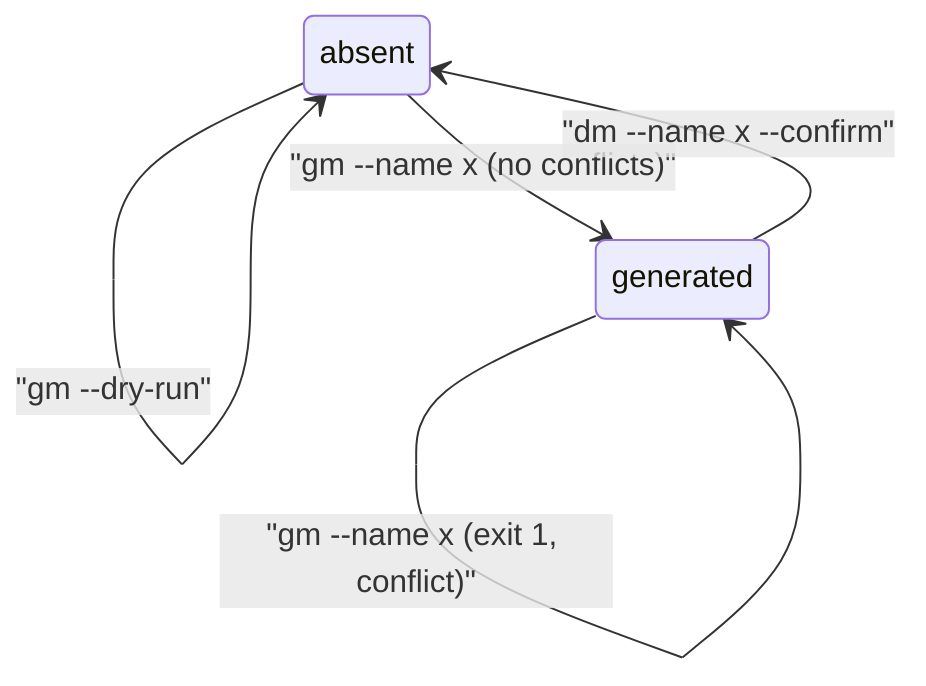

# Data Model: Model Gateway Generation

No new CLI data types. The existing `ModuleContext` (`src/scaffold_ca_python/models/context.py`) supplies every value the templates need.

## Template context (existing `ModuleContext.model_dump()`)

| Field | Example (`--name research_paper`, project `my-app`) | Used by |
|---|---|---|
| `module_name` | `research_paper` | folder and file names, test function names |
| `class_name` | `ResearchPaper` | model class, `<class_name>Repository`, docstrings |
| `project.python_package` | `my_app` | test import paths |

## Generated artifacts (per `gm` invocation)

| # | Path (relative to project root) | Template | Content |
|---|---|---|---|
| 1 | `src/<pkg>/domain/model/<module_name>/__init__.py` | `model/__init__.py.jinja2` | docstring only |
| 2 | `src/<pkg>/domain/model/<module_name>/<module_name>.py` | `model/model.py.jinja2` | `class <ClassName>(BaseModel)` (unchanged) |
| 3 | `src/<pkg>/domain/model/<module_name>/gateways/__init__.py` | `model/gateways_init.py.jinja2` | docstring only |
| 4 | `src/<pkg>/domain/model/<module_name>/gateways/<module_name>_repository.py` | `model/gateway.py.jinja2` | empty `class <ClassName>Repository(ABC)` |
| 5 | `src/tests/domain/model/<module_name>/test_<module_name>.py` | `model/test_model.py.jinja2` | instantiates the model |
| 6 | `src/tests/domain/model/<module_name>/gateways/test_<module_name>_repository.py` | `model/test_gateway.py.jinja2` | asserts `issubclass(<ClassName>Repository, ABC)` |

## Model Package lifecycle

Conflict paths, checked in this order, each exit 1 with a hint:

1. `src/<pkg>/domain/model/<module_name>/`
2. `src/<pkg>/domain/model/<module_name>.py` (legacy flat layout)
3. `src/tests/domain/model/<module_name>/`
