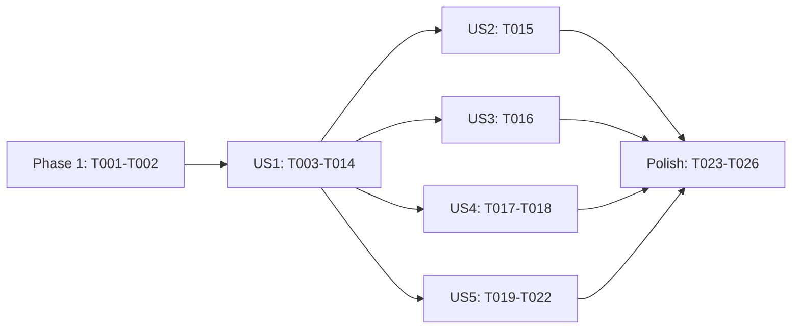

---

description: "Task list for model gateway generation"
---

# Tasks: Model Gateway Generation

**Input**: Design documents from `/specs/025-model-gateway-generation/`

**Prerequisites**: [plan.md](plan.md), [spec.md](spec.md), [research.md](research.md), [data-model.md](data-model.md), [contracts/](contracts/), [quickstart.md](quickstart.md)

**Tests**: Required. Constitution Principle V (test-first, non-negotiable) applies. In each story, the test tasks come first and must fail before the implementation tasks start.

**Organization**: Tasks are grouped by user story so each story can be implemented and tested on its own.

## Format: `[ID] [P?] [Story] Description`

- **[P]**: Can run in parallel (different files, no dependencies on incomplete tasks)
- **[Story]**: User story from spec.md (US1–US5)
- Paths are relative to the repository root. "Generated project" paths (`src/<pkg>/...`, `src/tests/...`) are what the CLI writes inside a scaffolded project. CLI test paths start with `tests/`.

---

## Phase 1: Setup

**Purpose**: Branch and baseline (Constitution Principle VII)

- [ ] T001 Create the feature branch from `main`: `git checkout main && git pull && git checkout -b feature/model-gateway-generation`, then commit `specs/025-model-gateway-generation/` and `.specify/feature.json` on it
- [ ] T002 Run the baseline checks `uv run ruff check`, `uv run ruff format --check`, `uv run mypy src`, and `uv run pytest` from the repository root and confirm they pass before any change (record any pre-existing failure in the PR description)

---

## Phase 2: Foundational

**Purpose**: None. Every story builds on the package layout delivered by US1, so US1 is the foundation and must finish first (see Dependencies).

---

## Phase 3: User Story 1 - Generate a model together with its gateway (Priority: P1) 🎯 MVP

**Goal**: `scaffold gm --name paper` creates the 6 files listed in [data-model.md](data-model.md): the model package, the `gateways/` sub-package with an empty `PaperRepository(ABC)`, and the mirrored test stubs.

**Independent Test**: In a fresh project, `scaffold gm --name order` exits 0, prints `Created 6 file(s).`, creates the 6 paths, and the generated project's ruff, mypy, and pytest checks pass.

### Tests for User Story 1 (write first, must fail)

- [ ] T003 [P] [US1] In `tests/templates/test_model_templates.py`, add rendering tests with the existing `_ctx()` (`order`, project `my-app`). `model/gateway.py.jinja2` must contain `from abc import ABC` and `class OrderRepository(ABC):`, and must NOT contain `import` of `my_app.domain.model` or the word `BaseModel`. `model/test_gateway.py.jinja2` must contain `from my_app.domain.model.order.gateways.order_repository import OrderRepository` and `issubclass(OrderRepository, ABC)`. `model/__init__.py.jinja2` and `model/gateways_init.py.jinja2` must each render a docstring containing `Order`. `model/test_model.py.jinja2` must contain `from my_app.domain.model.order.order import Order`.
- [ ] T004 [P] [US1] In `tests/factory/simple/test_model_factory.py`, update `test_model_files_queued_in_dry_run` to expect exactly these 6 paths: `src/ms_demo/domain/model/order/__init__.py`, `src/ms_demo/domain/model/order/order.py`, `src/ms_demo/domain/model/order/gateways/__init__.py`, `src/ms_demo/domain/model/order/gateways/order_repository.py`, `src/tests/domain/model/order/test_order.py`, `src/tests/domain/model/order/gateways/test_order_repository.py`. Also assert `len(preview) == 6`.
- [ ] T005 [US1] In `tests/commands/test_generate_model.py`, keep the existing validation, project-root, and no-argument help tests unchanged (FR-009). Update the existing path assertions (`test_creates_model_file`, `test_creates_test_mirror`, `test_model_file_contains_pydantic_basemodel`, `test_test_file_contains_pytest_stub`, `test_generate_model_alias_works`, `test_snake_name_generates_pascal_class`, `test_dry_run_writes_nothing`) to the package layout (`domain/model/<name>/<name>.py`, `src/tests/domain/model/<name>/test_<name>.py`). Add these tests:
  - `test_creates_gateway_file`: `domain/model/order/gateways/order_repository.py` exists and contains `class OrderRepository(ABC):`.
  - `test_creates_package_inits`: both `__init__.py` files exist.
  - `test_creates_gateway_test_mirror`: `src/tests/domain/model/order/gateways/test_order_repository.py` exists.
  - `test_success_message_counts_six_files`: output contains `Created 6 file(s).`
  - `test_gateway_has_no_outward_imports`: gateway content has no `infrastructure`, `application`, or `domain.model.order.order` import.
  - `test_generated_model_passes_structure_validation`: after `gm --name order`, run `vs`. Assert exit 0 and that the output contains `no violations` (case-insensitive), as in `tests/commands/test_validate_structure.py` (SC-003).

### Implementation for User Story 1

- [ ] T006 [P] [US1] Create `src/scaffold_ca_python/templates/model/__init__.py.jinja2` with the single line `"""{{ class_name }} domain model package."""`
- [ ] T007 [P] [US1] Create `src/scaffold_ca_python/templates/model/gateways_init.py.jinja2` with the single line `"""{{ class_name }} gateways."""`
- [ ] T008 [P] [US1] Create `src/scaffold_ca_python/templates/model/gateway.py.jinja2` with the exact shape from [contracts/gm.md](contracts/gm.md): module docstring `"""{{ class_name }} gateway."""`, `from abc import ABC`, and `class {{ class_name }}Repository(ABC):` whose body is only the docstring `"""Repository contract for {{ class_name }}. Add the operations your domain needs."""`. No methods, no other imports.
- [ ] T009 [P] [US1] Create `src/scaffold_ca_python/templates/model/test_gateway.py.jinja2`: it imports `ABC` and `{{ class_name }}Repository` from `{{ project.python_package }}.domain.model.{{ module_name }}.gateways.{{ module_name }}_repository`, and defines `def test_{{ module_name }}_repository_is_abstract_contract() -> None:` asserting `issubclass({{ class_name }}Repository, ABC)`. The import order must satisfy ruff `I` (stdlib block, blank line, first-party block).
- [ ] T010 [P] [US1] In `src/scaffold_ca_python/templates/model/test_model.py.jinja2`, change the import to `from {{ project.python_package }}.domain.model.{{ module_name }}.{{ module_name }} import {{ class_name }}`
- [ ] T011 [US1] Rewrite `ModelFactory.build` in `src/scaffold_ca_python/factory/simple/model_factory.py` (depends on T006–T010). Set `src_dir = .../domain/model/<module_name>`, `gateways_dir = src_dir / "gateways"`, and the matching `test_dir` / `test_dir / "gateways"`. Queue the 6 files in the [data-model.md](data-model.md) table order with `builder.add_file`, passing `is_test=True` for the two test files. Update the docstring's "Queues files" list.
- [ ] T012 [US1] In `src/scaffold_ca_python/commands/generate_model.py`, replace the flat-file `ensure_absent` call with one on the package directory `src/<pkg>/domain/model/<module_name>` using `kind="Directory"` and the existing hint text
- [ ] T013 [P] [US1] In `tests/commands/test_workflow.py`, change `test_workflow_gm_creates_model` to assert `src/order_service/domain/model/order/order.py` and `src/order_service/domain/model/order/gateways/order_repository.py` exist
- [ ] T014 [P] [US1] In `tests/commands/test_performance.py`, change `test_gm_performance` to run `gm --name perf_model` instead of `PerfModel` (PascalCase fails validation, so the benchmark currently measures an error exit), and assert `exit_code == 0` inside `run()`. Replace the flat-file cleanup with `shutil.rmtree(..., ignore_errors=True)` on `src/bench_app/domain/model/perf_model/` and `src/tests/domain/model/perf_model/`.

**Checkpoint**: T003–T005 pass. `scaffold gm --name order` produces the 6 files in a fresh project.

---

## Phase 4: User Story 2 - Multi-word model names produce consistent names (Priority: P1)

**Goal**: `--name research_paper` yields consistent folder, file, and class names.

**Independent Test**: `scaffold gm --name research_paper` creates `domain/model/research_paper/research_paper.py` (`class ResearchPaper`) and `domain/model/research_paper/gateways/research_paper_repository.py` (`class ResearchPaperRepository`), plus the 2 mirrored tests.

- [ ] T015 [US2] In `tests/commands/test_generate_model.py`, add `test_multi_word_name_layout`, which runs `gm --name research_paper` and asserts the 4 source paths and 2 test paths from spec US2, `class ResearchPaper(BaseModel)` in the model, and `class ResearchPaperRepository(ABC):` in the gateway. Also add:
  - `test_generating_second_model_leaves_first_untouched`: generate `paper`, record the contents of its 6 files, generate `research_paper`, and assert the `paper` files are unchanged.
  - `test_name_ending_in_repository`: `gm --name paper_repository` exits 0 and creates `domain/model/paper_repository/gateways/paper_repository_repository.py`.

  If any of these fail, fix the naming in `src/scaffold_ca_python/factory/simple/model_factory.py` (use `module_ctx.module_name` / `class_name` everywhere, never the raw `name`).

**Checkpoint**: US1 and US2 tests pass together.

---

## Phase 5: User Story 3 - Preview generation with dry-run (Priority: P2)

**Goal**: `--dry-run` lists all 6 files and writes nothing.

**Independent Test**: `scaffold gm --name order --dry-run` exits 0, the output contains each of the 6 relative paths, and none of them exists afterwards.

- [ ] T016 [US3] In `tests/commands/test_generate_model.py`, add `test_dry_run_lists_all_six_files`. It asserts the output (via `strip_ansi`) contains `order_repository.py`, `test_order_repository.py`, `order.py`, `test_order.py`, and `__init__.py`, and that neither `domain/model/order/` nor `src/tests/domain/model/order/` exists afterwards. No production change is expected, because `print_dry_run_tree` already prints every queued path. Confirm `tests/commands/test_dry_run_checksum.py` still passes; its `project_with_model` fixture runs `gm`.

**Checkpoint**: Dry-run paths match the real run paths.

---

## Phase 6: User Story 4 - Prevent overwriting existing models (Priority: P2)

**Goal**: Each of the 3 conflict paths exits with code 1 and a hint, before anything is written.

**Independent Test**: For each conflict path in [contracts/gm.md](contracts/gm.md), pre-create it, run `gm --name order`, and assert exit 1, the error text, the `Hint:` line, and that no other model or test path was created.

### Tests for User Story 4 (write first, must fail)

- [ ] T017 [US4] In `tests/commands/test_generate_model.py`, add these tests:
  - `test_existing_package_dir_exits_1`: run `gm` twice. Assert exit 1 and that the output contains `Directory 'src/my_app/domain/model/order/' already exists.` and `Hint:`.
  - `test_legacy_flat_model_exits_1`: create `src/my_app/domain/model/order.py`. Assert exit 1, the output contains `File 'src/my_app/domain/model/order.py' already exists.`, and `domain/model/order/` was not created.
  - `test_existing_tests_dir_exits_1`: create the empty folder `src/tests/domain/model/order/`. Assert exit 1, the output contains `Directory 'src/tests/domain/model/order/' already exists.`, and `src/my_app/domain/model/order/` was not created.
  - Replace the existing `test_duplicate_model_exits_1` with these tests.

### Implementation for User Story 4

- [ ] T018 [US4] In `src/scaffold_ca_python/commands/generate_model.py`, after the T012 check and before building, add two `ensure_absent` calls. The first checks the legacy file `src/<pkg>/domain/model/<module_name>.py` (`kind="File"`, hint: `"A model with this name already exists in the legacy flat layout. Remove it or choose a different name."`). The second checks `resolve_tests_root(project_root) / "domain" / "model" / module_name` (`kind="Directory"`, hint: `"Remove the leftover tests folder or choose a different name."`). Keep the order: package dir, legacy file, tests dir.

**Checkpoint**: All 3 conflict tests pass, and the US1–US3 tests still pass.

---

## Phase 7: User Story 5 - Delete a model generated with the new layout (Priority: P3)

**Goal**: `dm` finds and removes the model package and its tests folder, and legacy flat models still work.

**Independent Test**: After `gm --name order`, `dm --name order --confirm` removes `src/my_app/domain/model/order/` and `src/tests/domain/model/order/`. A hand-made legacy `order.py` and `test_order.py` pair is also removed.

### Tests for User Story 5 (write first, must fail)

- [ ] T019 [P] [US5] In `tests/core/test_module_locator.py`, add these tests:
  - `test_model_package_returns_dirs`: given `src/my_proj/domain/model/order/` and `tests/domain/model/order/`, the result contains `(package_dir, tests_dir)`.
  - `test_model_package_without_tests_returns_none`.
  - `test_model_package_listed_before_legacy_flat`: both `order/` and `order.py` exist, and `results[0][0]` is the package dir.
  - Keep the existing legacy tests (`test_model_with_test_returns_src_and_test`, `test_search_order_model_first`) unchanged.
- [ ] T020 [P] [US5] In `tests/commands/test_delete_module.py`, the fixture creates `order` via `gm`. Update `test_default_no_confirm_writes_nothing`, `test_dry_run_without_confirm_writes_nothing`, `test_confirm_deletes_model_file`, `test_confirm_deletes_test_file`, and `test_dry_run_with_confirm_takes_precedence` to use `src/my_app/domain/model/order/` and `src/tests/domain/model/order/`. Add these tests:
  - `test_confirm_deletes_gateway`: `domain/model/order/gateways/` is gone.
  - `test_preview_lists_package_and_tests_dirs`: output contains `domain/model/order` and `src/tests/domain/model/order`.
  - `test_confirm_deletes_legacy_flat_model`: manually create `src/my_app/domain/model/legacy.py` and `src/tests/domain/model/test_legacy.py`, run `dm --name legacy --confirm`, and assert both are gone.

### Implementation for User Story 5

- [ ] T021 [US5] In `src/scaffold_ca_python/core/module_locator.py`, add a directory candidate `(src_root / "domain" / "model" / snake, tests_root / "domain" / "model" / snake)` first in the search. It is appended only when the source path is a directory, with the test path kept only if it exists. Keep the legacy flat-file candidate after it. Update the docstring's search order.
- [ ] T022 [US5] In `src/scaffold_ca_python/factory/simple/delete_module_factory.py`, replace the duplicated candidate-building code in `build` with `candidates = find_module_targets(project_root, pkg, snake_name)` (import from `scaffold_ca_python.core.module_locator`). Remove the now-unused `resolve_tests_root` / `Path` imports, keep `_delete_path` as is, and update the docstring. Confirm `tests/factory/simple/test_delete_module_factory.py` still passes.

**Checkpoint**: All US5 tests pass, and the `dm` tests for helpers, adapters, and entry points still pass.

---

## Phase 8: Polish & Cross-Cutting Concerns

- [ ] T023 [P] In `src/scaffold_ca_python/commands/generate_model.py`, update `_GM_HELP` to `"Scaffold a Pydantic v2 domain model, its gateway, and test stubs. Alias 'gm'."` and the command docstring to `"""Scaffold a domain model package with its gateway in domain/model/<name>/."""`. Keep the existing examples in `_GM_EPILOG`.
- [ ] T024 [P] In the `### scaffold gm` section of `README.md`, change the description to mention the gateway, and add the generated tree for `--name order` (`domain/model/order/{__init__.py, order.py, gateways/{__init__.py, order_repository.py}}`)
- [ ] T025 Run [quickstart.md](quickstart.md) steps 1–4 in a temporary directory and confirm every expected outcome. In particular, the generated project's `ruff check`, `ruff format --check`, `mypy src`, `pytest`, and `scaffold vs` all exit 0 (SC-002, SC-003).
- [ ] T026 Run `uv run ruff check`, `uv run ruff format --check`, `uv run mypy src`, and `uv run pytest` from the repository root. All must pass, with coverage ≥ 80% (SC-007).

---

## Dependencies & Execution Order

- **Setup → US1**: the branch must exist before any change.
- **US1 blocks US2–US5**: they all assume the package layout.
- **US2, US3, US4, US5** are independent of each other once US1 is done. However, US2, US3, and US4 all edit `tests/commands/test_generate_model.py`, so run them one after another, or merge carefully.
- **Within a story**: tests come first and must fail, then the implementation. T011 depends on T006–T010. T012 and T018 edit the same file, so run them in sequence.

## Parallel Examples

- **US1 tests**: T003 and T004 (different files), then T005.
- **US1 templates**: T006, T007, T008, T009, and T010 together. Then T011, then T012. T013 and T014 can run in parallel with T011.
- **US5**: T019 and T020 together, then T021, then T022.
- **Across stories, after US1**: US5 (T019–T022) can run alongside US2, US3, and US4, because they touch different files.
- **Polish**: T023 and T024 together.

## Implementation Strategy

1. **MVP**: Setup, then US1. After that, `gm` generates the model plus its gateway, and the generated project is green.
2. **Increment 2**: US2 and US3, which mostly add tests to confirm naming and dry-run.
3. **Increment 3**: US4, so existing models can't be overwritten.
4. **Increment 4**: US5, so `dm` handles the new layout.
5. **Finish**: Polish, then open a PR from `feature/model-gateway-generation` to `main`.
